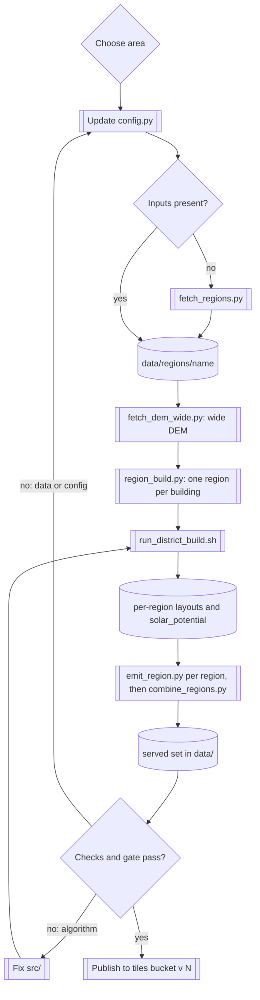

# Dataset operations

How to fetch, build, check and publish the map data. Run commands from the
project folder with `.venv` active. `config.py` defines regions, surveys,
layer IDs, exclusions and PV assumptions.

District builds run on the build VM, never on a laptop. A laptop builds one
small region at a time (see the [quickstart](../quickstart.md)).

## The flow



## Source data

Layer IDs per survey are in `config.SURVEYS`.

| Data | Source | Used for |
| --- | --- | --- |
| Building outlines, layer [101290](https://data.linz.govt.nz/layer/101290) | LINZ Data Service (WFS 1.0.0) | The buildings estimated. `src/fetch_data.py`, `src/fetch_regions.py` |
| LiDAR 1 m DSM: Queenstown 2021 ([105855](https://data.linz.govt.nz/layer/105855)), Wanaka 2022 ([113096](https://data.linz.govt.nz/layer/113096)), Kingston 2025 ([123405](https://data.linz.govt.nz/layer/123405)), Auckland 2024 (121992) | LINZ Exports API | Roof and obstacle heights, shading, heat map |
| LiDAR bare-earth DEM: 105898, 113095, 123404 | LINZ | Configured but not fetched; horizons use the wide DEM |
| LiDAR tile index: 105905, 113097, 123527, 121993 | LINZ | Maps an area to point-cloud tiles. `src/fetch_pointcloud_regions.py` |
| Raw point clouds: [NZ21_Otago](https://opentopography.s3.sdsc.edu/pc-bulk/NZ21_Otago), [NZ22_Wanaka](https://opentopography.s3.sdsc.edu/pc-bulk/NZ22_Wanaka), NZ24_Auckland | OpenTopography | Point-level roof evidence. Kingston has none and uses its DSM |
| Aerial imagery: Queenstown 2026 (124754), Wanaka 2022–23 (112781), Kingston (106403), Cromwell (119455), Glenorchy (104460), Auckland (121752) | LINZ | Roof lines and obstructions. Optional: builds carry on without it |
| Survey-year imagery: Queenstown 2021 (114745), Wanaka (112781), Auckland (121752) | LINZ | Measuring each building's photo lean. `src/register_imagery.py` |
| NZ 8 m DEM, layer [51768](https://data.linz.govt.nz/layer/51768) | LINZ | Distant horizons. Fetched to `data/dem_wide_mosaic.tif` by `src/fetch_dem_wide.py` |
| NZ Addresses, layer [123113](https://data.linz.govt.nz/layer/123113) | LINZ | Address labels and search. `src/add_addresses.py` |
| Measured sunlight | NIWA SolarView GHI (Wakatipu basin); else the nearest NIWA measured-radiation station | Sunlight calibration. `src/solar_model.py` |
| ERA5 daily radiation, 1940–2025 | Copernicus, via Open-Meteo (CC BY 4.0) | Scales calibration between places; low-solar runs. `climate/era5/`, `tools/pack_era5_daily.py` |
| District plan zones | Queenstown Lakes District Council | Home or business pricing. `tools/fetch_zoning.py` |
| Aerial basemap | LINZ Basemaps | Map display; reference photo for lean. `preview.html`, `src/register_imagery.py` |
| World imagery basemap | Esri World Imagery | Low-zoom map display only |

Where there is no LiDAR (Cromwell, Glenorchy), the survey is marked
`"elevation": "synthetic"` and the build uses a modelled surface
(`src/synthesize_dsm.py`).

## 1. Choose an area

Check LINZ has outlines, DSM and imagery for it, then add the region and its
bounding box to `config.REGIONS`. The original pilot is `pilot`; its inputs
start in `data/` and are linked into `data/regions/pilot/`.

## 2. Fetch

```sh
.venv/bin/python src/fetch_regions.py frankton_flats   # one region
.venv/bin/python src/fetch_regions.py                  # every region
.venv/bin/python src/fetch_dem_wide.py                 # wide DEM, if missing or too small
```

Each region lands in `data/regions/<region>/`. Fetching resumes: existing
files are skipped. Imagery is fetched in chunks of at most 8 km². Areas with
no imagery log a warning and build from LiDAR alone. `src/fetch_data.py`
fetches the legacy pilot inputs into `data/`.

## 3. Prepare

After fetching every region you will combine, give each building one owning
region:

```sh
.venv/bin/python src/region_build.py
```

## 4. Build

```sh
bash src/run_district_build.sh                       # incremental: stale buildings only
bash src/run_district_build.sh --regions "pilot frankton_flats"
bash src/run_district_build.sh --force               # rebuild everything
bash src/run_district_build.sh --yield-only          # solar model changed: recompute kWh, no LiDAR
```

Per region it runs `register_imagery`, `build_layout_geojson`, `gate_panels`,
`rerank_layouts`, `derive_solar_potential`, `patch_roof_confidence`,
`bake_building_horizons`, `build_heatmap_raster`, `add_addresses`, then
`emit_region`, which writes the region's tiles, cells, detail and summary to
`data/out/<region>/`. Then `src/combine_regions.py` joins every region into
the served set in `data/`. There is no merged district file
(`src/merge_regions.py` is retired).

Each stage runs through `src/run_stage.py`: it checks inputs first and
writes a marker to `data/build_state/` on success. A rerun skips stages whose
marker is newer than their inputs, so an interrupted build resumes. Logs are
in `data/build_logs/<region>.log`. A failed region stops the combine.

For fast layout work on one area: `bash src/run_dev_loop.sh pilot`.

## 5. Check

1. Read each region's log for failures and warnings.
2. `src/audit_layout_quality.py`: low fill, scattered arrays, mixed angles,
   too much obstruction.
3. `src/render_top_movers.py`: picture cards of the buildings that changed
   most.
4. `src/render_building_debug.py <building_id>`: one roof's faces, planes and
   panels.
5. `src/validate_obstructions.py` when obstruction rules change.
6. For layout changes, see "Judging a layout change" in [AGENTS.md](../../AGENTS.md)
   (`tools/layout_ab.py`, `tools/layout_health.py`, `tools/face_area_check.py`).
7. Look at the map: a mix of roofs, known hard cases, areas without imagery.

Run the tests before pushing code:

```sh
bash tests/run_all.sh --fast   # unit, economics, sync and diagram checks
bash tests/run_all.sh          # adds the whole build on a synthetic region
```

## 6. Serve locally

```sh
python3 -m http.server 8000
```

Open `http://localhost:8000/preview.html`. For the tuning sliders, run
`.venv/bin/python src/live_server.py` instead. It serves the folder above the
project, so open `http://localhost:8000/<project-folder>/preview.html`.
`tools/pipeline_serve.py` serves a preview with PMTiles range requests.

## 7. Publish

The site (`preview.html` and its scripts) is served by GitHub Pages from this
repository. The data is served from the Google Cloud tiles bucket, one folder
per release: `gs://solar-potential-map-tiles/v<N>/`. `site-config.js`
(`dataBase`, `dataVersion`) tells the page which folder to read.

From GitHub (Actions > "Build and publish the map") or a laptop
(`tools/remote_build.sh --publish`), the VM builds, gates and publishes. To
review a VM build on a laptop first:

```sh
tools/deploy_from_vm.sh                          # pull the served set, run the gate, stop
tools/deploy_from_vm.sh --push                   # ...and publish if the gate passes
tools/deploy_from_vm.sh --push-reviewed "why"    # publish past a gate whose list you have checked
```

The gate is `tools/predeploy_check.py`: it compares the new build against the
live one. Publishing (`tools/publish_served.py`) uploads a new version
folder, keeps the newest three, and commits only the `site-config.js` change.
A version folder is never changed after upload.

**Roll back** by pointing `site-config.js` `dataBase` and `dataVersion` at an
older folder that is still in the bucket.

## Safety

- JSON outputs are replaced atomically: an interruption leaves the old file
  or a complete new one.
- After a network failure, rerun the fetch. Don't delete complete files.
- Keep the code revision, config, logs and check results with each release.
