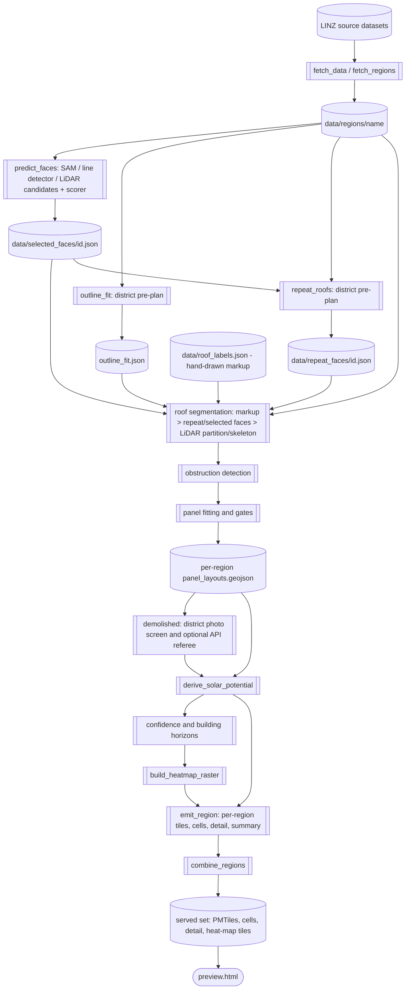

# Architecture

Data flow and module responsibilities for developers. For command delegation,
machine boundaries and build-engine differences, use
[tooling and execution](tooling-execution.md). For validation tools and review
rules, use the [reviewer's guide](reviewers-guide.md).

## What it is

A Python geospatial pipeline and a static MapLibre map. The pipeline turns
LINZ building outlines, LiDAR, elevation models and aerial imagery into
per-building roof faces, panel layouts and yields. The map (`preview.html`)
reads the published tiles and does the money maths in the browser.

## Data flow

This is a conceptual producer/consumer view, not a launcher call graph or
an exact stage schedule. Vision is optional in the local pipeline and a
separate preparation step for district builds.

Cylinders are data, subroutine boxes are scripts or stages, the rounded node
is the map. Per-region intermediates stay separate from the combined served
set; no root-level merged solar-potential GeoJSON is required by the map.
Outline-fit/repeated-roof precomputation and demolition screening are
district-path additions; local and worker orchestration do not run them.
Those builds can still read existing outline-fit/repeated-roof sidecars.
The direct layout-to-derive edge represents paths without demolition screening.

## Module boundaries

- `config.py`: model constants, source layer IDs, regions, exclusions, and
  the PV assumptions shown in the UI (`PV_ASSUMPTIONS`).
- `src/fetch_data.py`, `src/fetch_regions.py`: fetch inputs.
- `src/region_ids.py`: region id rules. An id is its path under
  `data/regions/` and `data/out/`: a LINZ locality
  `<council>/<town>/<suburb>` or a legacy `config.REGIONS` name.
  `list_regions` walks both shapes; `file_slug` flattens an id for markers
  and logs.
- `src/localities.py`, `tools/find_area.py`: LINZ NZ Suburbs and Localities
  lookup. `prepare` writes a locality's attribute-matched building outlines
  and `locality.json` (LINZ attributes, bbox) into `data/regions/<id>/`.
- `src/region_build.py`: region paths, and assigns each outline to exactly
  one region; a locality owns the buildings LINZ assigns to it. Region-aware
  tools use its path helpers.
- The pilot is special: its inputs start in `data/`, but
  `area_paths("pilot")` resolves to `data/regions/pilot/`. A fresh checkout
  needs the pilot inputs prepared there.
- `src/roof_segmentation.py`, `src/roof_partition.py`, `src/roof_skeleton.py`:
  roof faces. Hand-drawn markup takes precedence over repeated/selected faces
  and the LiDAR fallback; review gates are in the
  [reviewer's guide](reviewers-guide.md#roof-geometry-two-paths).
- `src/preflight.py` declares stage inputs; `src/run_stage.py` records
  completion and checks freshness for callers requesting marker-based skips.
- `src/build_layout_geojson.py`, `src/gate_panels.py`,
  `src/rerank_layouts.py`: fit, gate and rank panels.
- `src/derive_solar_potential.py`: building totals are summed from the
  layouts, never recomputed.
- `src/building_horizon.py`, `src/bake_building_horizons.py`: 72-bin
  horizon per building (`horizon_b64`, `horizon_beam_pct`) from the 8 m DEM
  and the 1 m DSM.
- `src/emit_region.py` writes each region's tiles, cells, detail, heat-map
  tiles, addresses and summary under `data/out/<region>/`.
  `src/combine_regions.py` joins regions into the served set without
  loading the district into memory. `src/output_contract.py` fixes the
  names the map reads. `src/merge_regions.py` is retired; nothing ships
  from it.
- `src/outline_fit.py`, `src/repeat_roofs.py`: fitted footprints and consensus
  readings for matching roof surfaces. `src/demolished.py` screens changed
  roofs, with an optional paid API; [authorization and limits](../data-maintainers/dataset-operations.md#demolition-screening).
- `src/run_district_build.sh`: district orchestration and per-building
  incremental planning (`src/build_keys.py`).
- `tools/pipeline.py`: local single-region orchestration and cloud
  dispatch; `quickstart.sh` is its compatibility wrapper.
- `src/local_queue.py`, `tools/pipeline_queue.py`: loopback coordination,
  JSON task persistence and subprocess workers for that local executor.
  One worker is the default; tasks in one checkout serialize. The existing
  GCS fleet queue is not yet migrated to this protocol.
- `tools/remote_build.sh`: shared-VM sync, district build, gate and optional
  publication; also called directly by the GitHub build workflow.
- `src/build_region.sh`, `src/worker.sh`, `src/gcs_queue.py`: regional worker
  build, queue ownership and regional publication. See
  [scale architecture](../maintainers/scale-architecture.md).
- `src/render_building_debug.py`, `src/render_top_movers.py`: debug cards
  and build-over-build diffs.
- `preview.html`: the map. `src/live_server.py` adds a local-only refit
  endpoint; keep it in step with the static build.
- `site-config.js`: per-deployment settings (data version and URL, default
  view, site name, towns in search).
- `bill_tool.js` prices every roof (household load, time-of-use prices,
  savings, payback). `economics.js` holds cost tiers, rates and the battery
  day simulation. `generation.js` and `workings.js` build each displayed
  figure and its breakdown. Each has a Node test in `tests/`.

## Principles

- Build from versioned code, config and source data.
- Metres in NZTM2000 (EPSG:2193); WGS84 (EPSG:4326) only for map output.
- Keep regions independent during heavy processing, to bound memory and
  allow resume.
- Generated data is a contract: change producer and consumer together.
- Make randomness deterministic, so a building's output does not depend on
  build order.
- Judge layouts by renders against the photo as well as by geometry checks.
