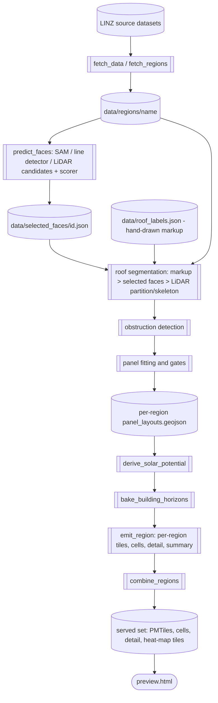

# Architecture

Reviewing rather than changing code? Start with the
[reviewer's guide](reviewers-guide.md).

## What it is

A Python geospatial pipeline and a static MapLibre map. The pipeline turns
LINZ building outlines, LiDAR, elevation models and aerial imagery into
per-building roof faces, panel layouts and yields. The map (`preview.html`)
reads the published tiles and does the money maths in the browser.

Cylinders are data, subroutine boxes are scripts or stages, the rounded node
is the map. `src/run_district_build.sh` runs the stages; `src/run_stage.py`
wraps each with preflight checks and completion markers.

## Module boundaries

- `config.py`: model constants, source layer IDs, regions, exclusions, and
  the PV assumptions shown in the UI (`PV_ASSUMPTIONS`).
- `src/fetch_data.py`, `src/fetch_regions.py`: fetch inputs.
- `src/region_build.py`: region paths, and assigns each outline to exactly
  one region. Region-aware tools use its path helpers.
- The pilot is special: its inputs start in `data/`, but
  `area_paths("pilot")` resolves to `data/regions/pilot/`. A fresh checkout
  needs the pilot inputs prepared there.
- `src/roof_segmentation.py`, `src/roof_partition.py`, `src/roof_skeleton.py`:
  roof faces. Precedence is hand-drawn markup, then selected faces, then the
  LiDAR partition and straight skeleton.
- `src/preflight.py` declares stage inputs; `src/run_stage.py` records
  completion so a build resumes.
- `src/build_layout_geojson.py`, `src/gate_panels.py`,
  `src/rerank_layouts.py`: fit, gate and rank panels.
- `src/derive_solar_potential.py`: building totals are summed from the
  layouts, never recomputed.
- `src/building_horizon.py`, `src/bake_building_horizons.py`: 72-bin
  horizon per building (`horizon_b64`, `horizon_beam_pct`) from the 8 m DEM
  and the 1 m DSM.
- `src/emit_region.py` writes each region's tiles, cells, detail, heat-map
  tiles, addresses and summary under `data/out/<region>/`.
  `src/combine_regions.py` joins regions into the served set without
  loading the district into memory. `src/output_contract.py` fixes the
  names the map reads. `src/merge_regions.py` is retired; nothing ships
  from it.
- `src/run_district_build.sh`: the release build. Incremental by default
  from per-building build keys (`src/build_keys.py`).
- `src/render_building_debug.py`, `src/render_top_movers.py`: debug cards
  and build-over-build diffs.
- `preview.html`: the map. `src/live_server.py` adds a local-only refit
  endpoint; keep it in step with the static build.
- `site-config.js`: per-deployment settings (data version and URL, default
  view, site name, towns in search).
- `bill_tool.js` prices every roof (household load, time-of-use prices,
  savings, payback). `economics.js` holds cost tiers, rates and the battery
  day simulation. `generation.js` and `workings.js` build each displayed
  figure and its breakdown. Each has a Node test in `tests/`.

## Principles

- Build from versioned code, config and source data.
- Metres in NZTM2000 (EPSG:2193); WGS84 (EPSG:4326) only for map output.
- Keep regions independent during heavy processing, to bound memory and
  allow resume.
- Generated data is a contract: change producer and consumer together.
- Make randomness deterministic, so a building's output does not depend on
  build order.
- Judge layouts by renders against the photo as well as by geometry checks.

## Workflow

Set up with the [local setup guide](../data-maintainers/local-setup.md).
Make a narrow change and check it with `bash src/run_dev_loop.sh pilot`.
Run the relevant audit before a regional rebuild. District builds use
`bash src/run_district_build.sh`.

Tests: `bash tests/run_all.sh --fast` for a quick check; the full run adds
golden-building tests that need local region data. CI
(`.github/workflows/tests.yml`) runs the unit tests and the JavaScript money
and workings tests. Add tests when you change a deterministic algorithm or a
data contract, and update the matching doc in the same change.
