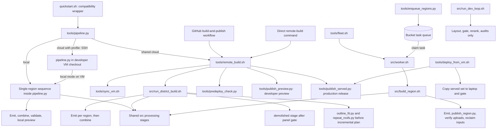
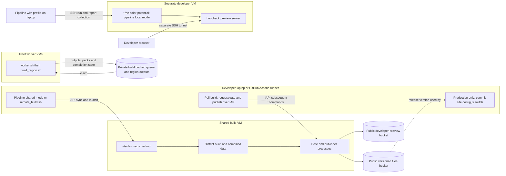
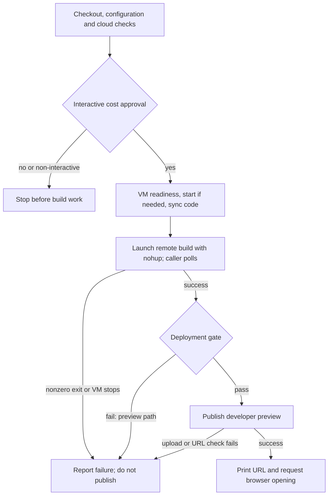

# Tooling and execution architecture

Trace who starts a workflow, where it runs and what it changes. This
describes the **current implementation**, not proof of live cloud readiness.
The [architecture overview](architecture.md) covers data flow and modules;
operator commands are in the [quickstarts](../index.md#data-maintainers).
Commands and configuration remain defined by the linked source files.
Scope: the main build, preview and release workflows, not an exhaustive
catalogue of research scripts or individual processing/debug commands.

## Entry points and delegation

Solid arrows below mean invocation or task hand-off, not data dependencies.
The three build engines share stage scripts, but not a common stage plan.

The remote launcher gates only after the district build succeeds.
Regional worker publication is **not** the production release gate: it
stores regional build outputs and packs, not a new live map version.
The deployment relay reviews an existing build; it does not build regions.
The sync helper does not launch a build, and the gate does not publish:
the caller invokes those steps separately and checks their results.

### Capability matrix

| Entry point | Execution and region selection | Code and preparation | Completion and side effects |
| --- | --- | --- | --- |
| [quickstart.sh](../../quickstart.sh) | Delegates all arguments to the pipeline | Selects the project Python environment; cloud mode can use system Python | No separate workflow |
| [pipeline.py](../../tools/pipeline.py), local | One configured region; defaults to `config.PIPELINE_REGION` | Current checkout; fetches inputs and wide DEM; optional prediction | Replaces combined map data with that region, validates map contract, starts loopback preview; no production publish |
| Pipeline, shared cloud | Shared VM; defaults to `CLOUD_SHARED_BUILD["regions"]`; positional argument selects one region | Syncs configured `ref`, not the caller's branch/SHA; uses existing regional inputs; no `--fetch` forwarded | District build, live-comparison gate, public developer preview; launcher requests browser opening |
| Pipeline, cloud profile | Developer VM; one region, defaulting to `PIPELINE_REGION` | Runs pipeline local mode in existing `~/nz-solar-potential` checkout over SSH; no automatic code sync | Collects report/log; preview requires a separate SSH-tunnel action; no public publication |
| [remote_build.sh](../../tools/remote_build.sh) / [GitHub workflow](../../.github/workflows/build-and-publish.yml) | Shared VM; `--regions "a b"` or district default when omitted | Syncs a branch (`main` by default); optional fetch; normal, force or yield-only build | Gates; optionally publishes production or developer preview, never both. Production switches and commits `site-config.js` |
| [run_district_build.sh](../../src/run_district_build.sh) | Run on build VM; explicit region list or `all_areas()` | Inputs and selected faces prepared separately; outline-fit/repeated-roof pre-plan steps; per-building incremental planner; force/yield-only options | Demolition screening on normal/force path; emits build regions, combines available emitted regions; no preview server or publication |
| [build_region.sh](../../src/build_region.sh) | One region on a worker; queue task can supply a bbox not in config | Attempts pack restore, fetches inputs, deduplicates outlines, predicts faces in shards | Emits region; publishes and reclaims inputs unless `--no-publish`; no combine or production gate |
| [enqueue_regions.py](../../tools/enqueue_regions.py), [fleet.sh](../../tools/fleet.sh), [worker.sh](../../src/worker.sh) | Queue from config or planner; workers claim regions | Fleet image plus startup `git pull`; no run-wide commit pinning | Per-region queue state and logs; optional worker self-deletion; no automatic global combine or live release |
| [run_dev_loop.sh](../../src/run_dev_loop.sh) | One or more areas, default `pilot`; existing inputs | Direct stage calls from current checkout | Layout/gate/rerank and quality audits; no emit, combine or publication |
| [deploy_from_vm.sh](../../tools/deploy_from_vm.sh) | Laptop relay of shared VM outputs | Existing build, no regional processing | Copies combined data locally, gates, optionally publishes release and commits site switch |

The shared pipeline's `regions` configuration can contain multiple names;
the positional CLI argument is one path-safe name, not a multi-region
selector. `--force`, `--yield-only`, fleet operations and production
publication are not exposed by the pipeline parser.

Lower-level tools remain callable directly. For serving,
[pipeline_serve.py](../../tools/pipeline_serve.py) supports the local map's
PMTiles byte-range requests; [live_server.py](../../src/live_server.py)
provides the local refit API. Individual stages, audits and
renderers are not automatically operations of the pipeline front door.

## Deployment and ownership

Source inputs come from LINZ/OpenTopography; these arrows omit those
downloads for clarity. Fleet setup and resource defaults are in
[fleet.sh](../../tools/fleet.sh), queue location in
[gcs_queue.py](../../src/gcs_queue.py), shared settings in
[config.py](../../config.py), and profile settings in
[cloud_profile.py](../../cloud_profile.py).

Shared-VM access uses IAP. The experimental profile implementation uses
its own SSH/firewall configuration; do not assume it has the shared VM's
deployment or authentication model.

## Regional workflow differences

This table describes ordering, not interchangeable command aliases.

| Phase | Pipeline local / profile VM | District / shared VM | Region worker |
| --- | --- | --- | --- |
| Inputs | Fetch region and shared wide DEM | Prepared separately, or remote launcher's optional `--fetch` | Restore pack or fetch; explicit point-cloud fetch on non-restore path |
| Prediction | Optional; missing dependencies/checkpoints or prediction failure can degrade/skip | Separate precompute, not part of district script | Sharded prediction; shard failure stops build; separate prediction marker |
| Imagery registration | After layout, derivation and horizons | Before layout | Before layout |
| Pre-plan | No outline-fit or repeated-roof precompute | `outline_fit.py`, then `repeat_roofs.py`, enabled by default; skipped for yield-only; failures warn and continue | No outline-fit or repeated-roof precompute |
| Geometry | Layout, gate, rerank, derive | Incremental clean/patch/full planner or forced layout; `demolished` after gate, before rerank/derive; yield-only substitutes `apply_yield` and omits demolition screening | Layout, gate, rerank, derive through stage markers |
| Enrichment | Verification report, confidence, horizons, heat map, optional addresses | Confidence, horizons, heat map, optional addresses | Confidence, horizons, heat map, optional addresses |
| Finish | Emit selected region, combine only that region, optional terrain, contract validator, preview | Emit per region, combine all available non-excluded emitted regions | Emit one region, optional regional upload/verification and input cleanup |

Evidence: [pipeline command sequence](../../tools/pipeline.py),
[district planner and stages](../../src/run_district_build.sh),
[worker region sequence](../../src/build_region.sh).
Registration order is a current difference, not a recommendation to copy it.
These paths must not be declared equivalent without output/regression tests.

The district-only pre-plan steps produce
`data/regions/<region>/outline_fit.json` and `data/repeat_faces/<id>.json`;
their contents feed build keys. Shared geometry consumers now import
`fitted_outlines`, and the selected-face path can prefer a repeated-roof
reading over the ordinary selected reading, while hand-drawn markup retains
precedence. Local/worker builds can therefore consume existing sidecars
without generating or refreshing them. See
[outline_fit.py](../../src/outline_fit.py),
[repeat_roofs.py](../../src/repeat_roofs.py),
[build_keys.py](../../src/build_keys.py) and
[roof_partition.py](../../src/roof_partition.py).

The district [demolished stage](../../src/demolished.py) withholds sufficiently
confident gone/replaced buildings and exempts hand-drawn roofs. Unlike the
other two engines, it can send image crops to a paid external API.
[Dataset operations](../data-maintainers/dataset-operations.md#demolition-screening)
owns its authorization requirements, switches and degraded-screening limits.
This extra work is not included in the quickstart's VM/hosting estimate.

`run_stage.py` writes completion markers and checks preconditions.
Skipping requires `--skip-done`, matching stage code hashes, and no newer
declared inputs. The local pipeline does **not** pass `--skip-done`;
rerunning it creates a new report and reruns the stage commands (individual
tools may still reuse inputs). District builds additionally use per-building
build keys; workers use stage skipping but not that district planner.
The worker's prediction marker is a separate existence check, not the
stage code/input freshness check.

`run_district_build.sh --regions` limits which regions are built, not the
final combined region set. Its unfiltered combine includes emitted regions
with summaries under `data/out/`, excluding `config.SERVED_EXCLUDE`.
By contrast, the local pipeline explicitly passes its region to combine.
See [combine_regions.py](../../src/combine_regions.py).

## Run lifecycle and evidence

There is no shared durable run registry or cancellation API. The following
is the **shared-cloud launcher flow**, not a supervisor state machine:

- **Local/profile runs:** the [pipeline reference](../data-maintainers/pipeline-reference.md#outputs)
  defines report locations and statuses; profile mode copies reports home.
  Local preview readiness probes the page for HTTP 200 and
  PMTiles byte ranges for HTTP 206; it does not verify browser rendering.
- **Shared runs:** the [cloud quickstart](../quickstart-cloud.md#shared-build-vm)
  locates the caller log. Remote `~/remote_build.log` is reused by subsequent
  launches; regional logs are under `data/build_logs/`.
  The build is detached, but the caller still owns polling, gate and
  publication requests. Disconnecting is not an end-to-end durability
  guarantee; the launcher also stops a VM it started on normal exit unless
  `--keep-running` was passed directly to it.
- **Fleet:** `queue/`, `claims/`, `done/`, `failed/` objects and per-worker
  logs. Heartbeats, stale-claim takeover and retry limits are implemented in
  [gcs_queue.py](../../src/gcs_queue.py); [status.py](../../tools/status.py)
  reports queue counts. These are region task records, not a unified run ID.
- **Browser success:** shared mode checks the returned URL, not browser
  rendering or successful opening. Bucket readiness is an
  [administrator prerequisite](../data-maintainers/team-access.md#preview-hosting-administration),
  not part of shared preflight.
- **Concurrency/control:** the GitHub workflow serializes its own runs;
  that does not lock direct laptop launches or create per-developer
  workspaces. No supported common stop/resume/status command exists.

Fleet code is present, but a multi-worker production rehearsal is not
established by this source inspection.

## Target direction: not implemented

The intended common front door is `tools/pipeline.py`. Keep this target
separate from the current diagrams above:

1. Define explicit operations and contracts: build region(s), development
   check, yield-only rebuild, fleet submission/status, preview and release.
   Keep production publication distinct from developer preview.
2. Route supported user operations through the front door while retaining
   specialized execution engines. Existing wrappers/Actions should delegate
   rather than acquire another copy of orchestration.
3. Before sharing stage plans, test the current ordering, input preparation,
   optional failures, incremental behaviour and combine scope. Then extract
   common planning/execution where semantics really match. The district-only
   outline-fit, repeated-roof and demolition additions make a dispatcher-only
   change insufficient to promise equivalent results across run modes.
4. Define run identity, code provenance, process ownership, logs and terminal
   states before adding a common dashboard or cancellation interface.
   A public status page must not imply public permission to stop builds.
5. Keep cloud cost approval before chargeable work. Extending an interactive
   interface to fleet/CI needs an explicit approval design, not an implicit
   bypass. Include external model/API use, data transfer and per-region
   budgets in that design; the current VM/hosting estimate omits the
   demolition referee.

No new CLI syntax is specified here: interface choices need agreement and
implementation before being shown as supported commands.

## Keeping this reference accurate

Update the matrix and relevant diagram in the same change as a launcher,
dispatch branch, stage order, storage side effect or run-lifetime change.
Use relative source links; keep volatile cloud values in configuration.
Archived plans are not evidence of live deployment.

The existing [diagram checker](../../tools/check_diagram.py) checks a
hand-maintained list of symbols/constants associated with an external
diagram. It does **not** parse or verify these Mermaid diagrams or their
call edges. [Cloud routing](../../tests/test_cloud_profiles.py),
[reporting](../../tests/test_quickstart_reporting.py) and
[map-preview tests](../../tests/test_quickstart_map.py) cover parts of the
implementation, not the completeness of this reference.

Future drift protection should check documented paths/options and dispatch
edges, and test shared stage-order invariants. Automated call-graph
generation alone cannot establish shell/SSH delegation, cleanup semantics
or which operations are safe to expose.
