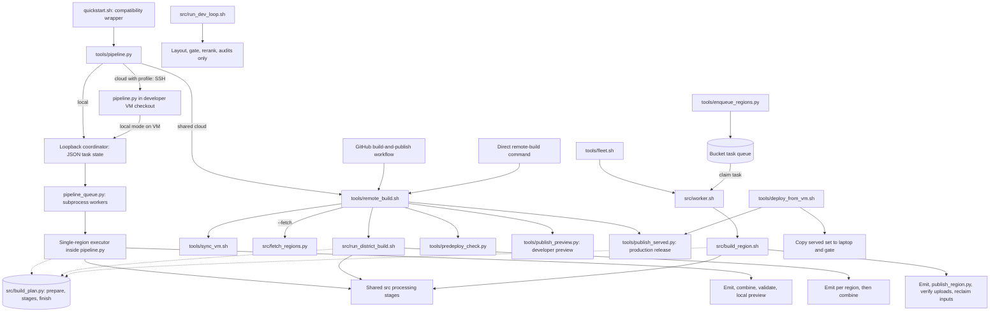
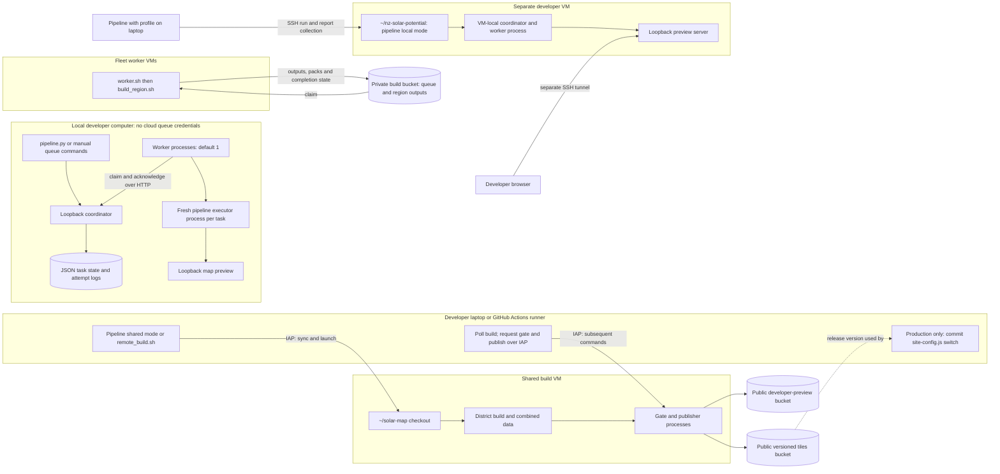
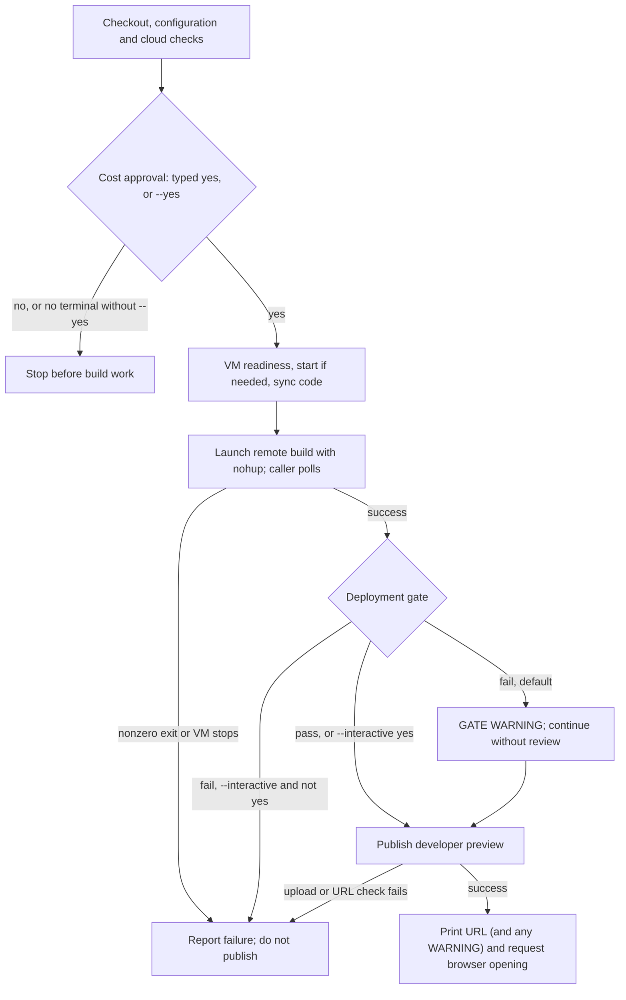
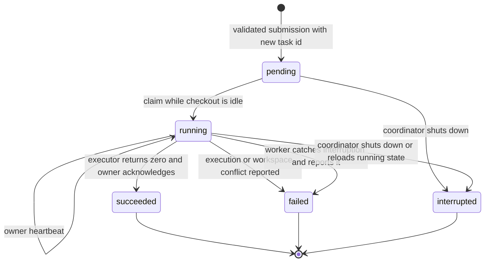

# Tooling and execution architecture

Trace who starts a workflow, where it runs and what it changes. This
describes the **current implementation**, not proof of live cloud readiness.
The [architecture overview](architecture.md) covers data flow and modules;
operator commands are in the [quickstarts](../index.md#data-maintainers).
Commands and configuration remain defined by the linked source files.
Scope: the main build, preview and release workflows, not an exhaustive
catalogue of research scripts or individual processing/debug commands.

## Entry points and delegation

Solid arrows below mean invocation or task hand-off, not data dependencies;
dotted arrows mean "reads". There is one launch path per audience, but three
**build engines** run regions: the local executor inside `pipeline.py`,
`run_district_build.sh` (shared VM, through `remote_build.sh`) and
`build_region.sh` (fleet workers). All three read their per-region step list
from one shared plan, [build_plan.py](../../src/build_plan.py); see
[Stage plans across engines](#stage-plans-across-engines) for what is shared
and what still differs.

The remote launcher gates only after the district build succeeds.
Regional worker publication is **not** the production release gate: it
stores regional build outputs and packs, not a new live map version.
The deployment relay reviews an existing build; it does not build regions.
The sync helper does not launch a build, and the gate does not publish:
the caller invokes those steps separately and checks their results.

### Capability matrix

| Entry point | Execution and region selection | Code and preparation | Completion and side effects |
| --- | --- | --- | --- |
| [quickstart.sh](../../quickstart.sh) | Delegates all arguments to the pipeline | Selects the project Python environment; cloud mode can use system Python | No separate workflow |
| [pipeline.py](../../tools/pipeline.py), local | One configured region via loopback queue; one worker by default | Current checkout; fetches inputs and wide DEM; optional prediction; shared plan steps; task provenance guards; asks the paid-referee question at start | Replaces combined map data with that region, validates map contract, starts loopback preview; no production publish |
| [pipeline_queue.py](../../tools/pipeline_queue.py) | Manual coordinator, submission, workers and status; no cloud credentials | JSON persistence; multiple worker processes; one active task per checkout | Runs existing local executor; explicit failure/interruption, no automatic retries |
| Pipeline, shared cloud | Shared VM; defaults to `CLOUD_SHARED_BUILD["regions"]`; positional argument selects one region | Syncs configured `ref`, not the caller's branch/SHA; uses existing regional inputs; no `--fetch` forwarded; forwards the paid-referee answer | District build, live-comparison gate, public developer preview; launcher requests browser opening |
| Pipeline, cloud profile | Developer VM; one region, defaulting to `PIPELINE_REGION` | Runs pipeline local mode in existing `~/nz-solar-potential` checkout over SSH; no automatic code sync; paid-referee answer passed as `SOLAR_DEMOLISHED_REFEREE` | Collects report/log; preview requires a separate SSH-tunnel action; no public publication |
| [remote_build.sh](../../tools/remote_build.sh) / [GitHub workflow](../../.github/workflows/build-and-publish.yml) | Shared VM; `--regions "a b"` or district default when omitted | Syncs a branch (`main` by default); optional fetch; normal, force or yield-only build; paid-referee question (or `--paid-referee`/`--no-paid-referee`, workflow input `paid_referee`) before any cloud call | Gates; optionally publishes production or developer preview, never both. Production switches and commits `site-config.js` |
| [run_district_build.sh](../../src/run_district_build.sh) | Run on build VM; explicit region list or `all_areas()` | Inputs and selected faces prepared separately; shared plan steps; per-building incremental planner; force/yield-only options | Demolition screening on normal/force path; emits build regions, combines available emitted regions; no preview server or publication |
| [build_region.sh](../../src/build_region.sh) | One region on a worker; queue task can supply a bbox not in config | Attempts pack restore, fetches inputs, deduplicates outlines, predicts faces in shards; shared plan steps | Emits region; publishes and reclaims inputs unless `--no-publish`; no combine or production gate |
| [enqueue_regions.py](../../tools/enqueue_regions.py), [fleet.sh](../../tools/fleet.sh), [worker.sh](../../src/worker.sh) | Queue from config or planner; workers claim regions | Fleet image plus startup `git pull`; no run-wide commit pinning; `fleet.sh up` asks the paid-referee question once and bakes the answer into worker startup | Per-region queue state and logs; optional worker self-deletion; no automatic global combine or live release |
| [run_dev_loop.sh](../../src/run_dev_loop.sh) | One or more areas, default `pilot`; existing inputs | Direct stage calls from current checkout | Layout/gate/rerank and quality audits; no emit, combine or publication |
| [deploy_from_vm.sh](../../tools/deploy_from_vm.sh) | Laptop relay of shared VM outputs | Existing build, no regional processing | Copies combined data locally, gates, optionally publishes release and commits site switch |

The shared pipeline's `regions` configuration can contain multiple names;
the positional CLI argument is one path-safe name, not a multi-region
selector. `--force`, `--yield-only`, fleet operations and production
publication are not exposed by the pipeline parser.

Lower-level tools remain callable directly. For serving,
[pipeline_serve.py](../../tools/pipeline_serve.py) supports the local map's
PMTiles byte-range requests; [live_server.py](../../src/live_server.py)
provides the local refit API. Individual stages, audits and
renderers are not automatically operations of the pipeline front door.

## Deployment and ownership

Source inputs come from LINZ/OpenTopography; these arrows omit those
downloads for clarity. Fleet setup and resource defaults are in
[fleet.sh](../../tools/fleet.sh), queue location in
[gcs_queue.py](../../src/gcs_queue.py), shared settings in
[config.py](../../config.py), and profile settings in
[cloud_profile.py](../../cloud_profile.py).

Shared-VM access uses IAP. The experimental profile implementation uses
its own SSH/firewall configuration; do not assume it has the shared VM's
deployment or authentication model.

## Stage plans across engines

Every build engine reads its per-region steps from
[build_plan.py](../../src/build_plan.py), in this order:

1. **Prepare** (`build_plan.PREPARE`): `outline_fit`, then `repeat_roofs`.
   Each has a switch (`SOLAR_OUTLINE_FIT`, `SOLAR_REPEAT_ROOFS`, default on);
   a failure warns and the build continues. Skipped on yield-only rebuilds.
2. **Stages** (`build_plan.STAGES`, through `run_stage.py`):
   `register_imagery`, `build_layout_geojson`, `gate_panels`, `demolished`,
   `rerank_layouts`, `derive_solar_potential`, `patch_roof_confidence`,
   `bake_building_horizons`, `build_heatmap_raster`. Yield-only rebuilds use
   `build_plan.YIELD_ONLY_STAGES` (`apply_yield`, then rerank onward).
3. **Finish** (`build_plan.FINISH`): `add_addresses` (failure warns), then
   `emit_region` (failure stops the region).

Shell engines read the lists through the plan's CLI
(`python3 src/build_plan.py stages|prepare|finish`).
[test_build_plan.py](../../tests/test_build_plan.py) fails when an engine
stops reading the plan or hard-codes a stage sequence, and when the local
executor's step list leaves out or reorders a plan step. The
[synthetic region](../../tests/synthetic/run.py) runs the plan's steps
except `add_addresses`, which needs the LINZ addresses service.

### Paid step: demolition referee

`demolished` screens every roof with no external cost. Its referee can send
photo crops of screened roofs to a paid vision API (Anthropic). The referee
is **off unless approved at the start of the run**: each entry point asks a
yes/no question, shows a conservative estimate (USD $0.004 a roof, stopping
near `SOLAR_DEMOLISHED_MAX_USD`, default USD $5 a region, so not a spending
cap), and takes only an explicit `yes`. Enter, any other answer, end of input
and non-interactive runs decline. A caller that has already set
`SOLAR_DEMOLISHED_REFEREE=0|1` is not asked again; `SOLAR_DEMOLISHED=0`
turns the stage off and is never asked. The answer travels to the engine as
`SOLAR_DEMOLISHED_REFEREE`. Where the question is asked:

| Entry point | Question | Non-interactive control |
| --- | --- | --- |
| `pipeline.py` local / profile `run` | After the VM cost confirmation (cloud) or before queueing (local) | `--paid-referee` / `--no-paid-referee`; `--yes` takes the default (no) |
| `pipeline.py` shared cloud | Inside the cost-confirmation step | Same flags; forwarded to `remote_build.sh` |
| `remote_build.sh` | After argument checks, before any cloud call | `--paid-referee` / `--no-paid-referee` |
| GitHub workflow | Not asked | `paid_referee` input, default false |
| `fleet.sh up` | Before creating workers | `SOLAR_DEMOLISHED_REFEREE` in the caller's environment |
| `run_district_build.sh`, `build_region.sh` | Only if not already decided; workers have no terminal and decline | `SOLAR_DEMOLISHED_REFEREE` |

[Dataset operations](../data-maintainers/dataset-operations.md#demolition-screening)
owns the referee's authorization requirements and degraded-screening limits.
This cost is not included in the quickstart's VM/hosting estimate.

### What still differs per engine

The plan covers the per-region steps. Everything around them is still
engine-specific:

| Phase | Pipeline local / profile VM | District / shared VM | Region worker |
| --- | --- | --- | --- |
| Inputs | Fetch region and shared wide DEM | Prepared separately, or remote launcher's optional `--fetch` | Restore pack or fetch; outline dedupe; explicit point-cloud fetch on non-restore path |
| Prediction | Optional; missing dependencies/checkpoints or prediction failure can degrade/skip | Separate precompute, not part of district script | Sharded prediction; shard failure stops build; separate prediction marker |
| Stage selection | Every plan step, every run | Per-building incremental planner (clean/patch/full), `--force`, `--yield-only` | Stage markers |
| Local-only steps | Verification report after derive; combine of this region only; optional terrain; contract validator; preview | none | none |
| Finish | Combine only that region | Combine all available non-excluded emitted regions | Optional regional upload/verification and input cleanup |

Evidence: [pipeline steps](../../tools/pipeline.py),
[district planner](../../src/run_district_build.sh),
[worker sequence](../../src/build_region.sh).
The engines run the same steps but are not declared output-equivalent: input
preparation and stage selection still differ.

The prepare steps produce `data/regions/<region>/outline_fit.json` and
`data/repeat_faces/<id>.json`; their contents feed build keys. Geometry
consumers import `fitted_outlines`, and the selected-face path can prefer a
repeated-roof reading over the ordinary selected reading, while hand-drawn
markup retains precedence. See
[outline_fit.py](../../src/outline_fit.py),
[repeat_roofs.py](../../src/repeat_roofs.py),
[build_keys.py](../../src/build_keys.py) and
[roof_partition.py](../../src/roof_partition.py).

`run_stage.py` writes completion markers and checks preconditions.
Skipping requires `--skip-done`, matching stage code hashes, and no newer
declared inputs. The local pipeline does **not** pass `--skip-done`;
rerunning it creates a new report and reruns the stage commands (individual
tools may still reuse inputs). District builds additionally use per-building
build keys; workers use stage skipping but not that district planner.
The worker's prediction marker is a separate existence check, not the
stage code/input freshness check.

`run_district_build.sh --regions` limits which regions are built, not the
final combined region set. Its unfiltered combine includes emitted regions
with summaries under `data/out/`, excluding `config.SERVED_EXCLUDE`.
By contrast, the local pipeline explicitly passes its region to combine.
See [combine_regions.py](../../src/combine_regions.py).

## Run lifecycle and evidence

There is no shared durable run registry or cancellation API. The following
is the **shared-cloud launcher flow**, not a supervisor state machine:

Production `remote_build.sh --publish` is not on this path: a failed gate
there still stops unless `--reviewed "why"` is given.

- **Local queue:** persistent tasks and attempt logs under
  `data/pipeline_queues/`; worker/attempt-checked acknowledgements and
  per-checkout exclusion. See [local operation and recovery](../data-maintainers/pipeline-reference.md#local-task-queue).
  Local persistence is not an end-to-end supervisor or automatic recovery.
- **Local/profile runs:** the [pipeline reference](../data-maintainers/pipeline-reference.md#outputs)
  defines report locations and statuses; profile mode copies reports home.
  Local preview readiness probes the page for HTTP 200 and
  PMTiles byte ranges for HTTP 206; it does not verify browser rendering.
- **Shared runs:** the [cloud quickstart](../data-maintainers/quickstart-cloud.md#shared-build-vm)
  locates the caller log. Remote `~/remote_build.log` is reused by subsequent
  launches; regional logs are under `data/build_logs/`.
  The build is detached, but the caller still owns polling, gate and
  publication requests. Disconnecting is not an end-to-end durability
  guarantee; the launcher also stops a VM it started on normal exit unless
  `--keep-running` was passed directly to it.
- **Fleet:** `queue/`, `claims/`, `done/`, `failed/` objects and per-worker
  logs. Heartbeats, stale-claim takeover and retry limits are implemented in
  [gcs_queue.py](../../src/gcs_queue.py); [status.py](../../tools/status.py)
  reports queue counts. These are region task records, not a unified run ID.
- **Browser success:** shared mode checks the returned URL, not browser
  rendering or successful opening. Bucket readiness is an
  [administrator prerequisite](../data-maintainers/team-access.md#preview-hosting-administration),
  not part of shared preflight.
- **Concurrency/control:** the GitHub workflow serializes its own runs;
  that does not lock direct laptop launches or create per-developer
  workspaces. No supported common stop/resume/status command exists.

Fleet code is present, but a multi-worker production rehearsal is not
established by this source inspection.

## Local queue consolidation boundary

### Task lifecycle

Queue states differ from numbered pipeline step statuses: a `succeeded`
task can have `DEGRADED` steps. Heartbeats do not expire claims or retry
tasks. For conflicts, shutdown/restart semantics and manual recovery, use
the [pipeline reference](../data-maintainers/pipeline-reference.md#evidence-conflicts-and-recovery).

### Execution and remaining differences

[local_queue.py](../../src/local_queue.py) supplies serialized HTTP queue
operations and atomic JSON state. [pipeline_queue.py](../../tools/pipeline_queue.py)
supplies process workers and calls `pipeline._run_local` in a fresh process.
Local and profile-VM pipeline runs therefore use the same local queue and
executor code. Coordinator and workspace ownership are explicit; human
coordination still governs old scripts and shared/symlinked input trees.

The first slice intentionally queues the **whole existing single-region
pipeline**, including combine/validation/preview. It does not claim
regional-only tasks, offline input acquisition, identical district outputs,
GCS queue compatibility or a resolved configuration snapshot. Shared cloud
and fleet keep their own engines (sharing the stage plan); the
[remaining work](#target-direction-remaining-work) tracks consolidation.

Cloud-free coverage in [test_local_queue.py](../../tests/test_local_queue.py)
exercises competing claims, different-workspace concurrency with actual
processes, failures, changed configuration, interruption, ownership
conflicts, persistence and existing pipeline dispatch/reporting.

## Target direction: remaining work

The intended common front door is `tools/pipeline.py`. Keep this target
separate from the current diagrams above:

1. Define explicit operations and contracts: build region(s), development
   check, yield-only rebuild, fleet submission/status, preview and release.
   Keep production publication distinct from developer preview.
2. Route supported user operations through the front door while retaining
   specialized execution engines. Existing wrappers/Actions should delegate
   rather than acquire another copy of orchestration.
3. **Done:** one stage plan ([build_plan.py](../../src/build_plan.py)) read
   by all three engines, with a drift test. **Remaining:** consolidate input
   preparation (fetch, prediction, outline dedupe, pack restore) into shared
   steps, then test output equivalence between engines before declaring
   them interchangeable.
4. Define run identity, code provenance, process ownership, logs and terminal
   states before adding a common dashboard or cancellation interface.
   A public status page must not imply public permission to stop builds.
5. Keep cloud cost approval before chargeable work. The paid referee now
   has a start-of-run question on every entry point (default no). Remaining:
   `fleet.sh up` has no VM cost confirmation, and the VM/hosting estimate
   still omits the referee and data transfer.

No new CLI syntax is specified here: interface choices need agreement and
implementation before being shown as supported commands.

## Keeping this reference accurate

Update the matrix and relevant diagram in the same change as a launcher,
dispatch branch, stage order, storage side effect or run-lifetime change.
Use relative source links; keep volatile cloud values in configuration.
Remove obsolete paths and redundant explanations when code is removed.
Archived plans are not evidence of live deployment.

The existing [diagram checker](../../tools/check_diagram.py) checks a
hand-maintained list of symbols/constants associated with an external
diagram. It does **not** parse or verify these Mermaid diagrams or their
call edges. [Cloud routing](../../tests/test_cloud_profiles.py),
[reporting](../../tests/test_quickstart_reporting.py) and
[map-preview tests](../../tests/test_quickstart_map.py) cover parts of the
implementation, not the completeness of this reference.

Future drift protection should check documented paths/options and dispatch
edges, and test shared stage-order invariants. Automated call-graph
generation alone cannot establish shell/SSH delegation, cleanup semantics
or which operations are safe to expose.
