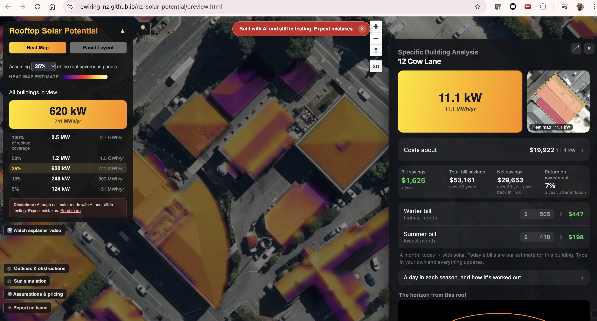
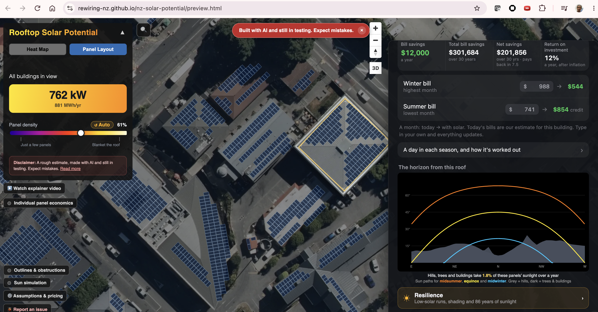

# Webmap interface

A web view of New Zealand's rooftop solar potential, publicly viewable from: **[rewiring-nz.github.io/nz-solar-potential/](https://rewiring-nz.github.io/nz-solar-potential/)**.

_Heatmap view of rooftop solarpotential_

_Panellayout view of rooftop solarpotential_

> [!WARNING]
> The map is a planning aid, not a system design, quote or guarantee.

### Developer map access

Data maintainers and developers can view their local updates. Use the URL printed when the build finishes; the destination depends on how it ran:

| Build or preview | Where to open it | Availability |
| --- | --- | --- |
| [Local quickstart](../data-maintainers/quickstart.md) | The printed **Map preview** URL, usually `http://127.0.0.1:8765/preview.html?...`; also recorded in the run's `report.md` | Only on your computer while the preview server runs. The port can change; the printed URL centres the map on the built region. |
| [Shared-cloud quickstart](../data-maintainers/quickstart-cloud.md#developer-preview) | The printed **Developer preview** URL: `https://storage.googleapis.com/rewiring-solar-previews/devel/GITHUB_ALIAS/preview.html` | Public and shareable. The alias opens its latest published preview; previews expire after 14 days unless refreshed. |
| [Developer-VM profile](../data-maintainers/quickstart-cloud.md#your-own-vm-profiles) | Start the documented `--cloud preview` SSH tunnel, then open `http://127.0.0.1:8765/preview.html` using the tunnel's port | Only on your computer while the VM's preview server and SSH tunnel run. It is not a public preview URL. |
| [District or worker build](../developers/tooling-execution.md#capability-matrix) without preview publication | No browser URL is created by the build alone. Use [Serve locally](../data-maintainers/dataset-operations.md#6-serve-locally) for combined outputs. | Worker outputs must be collected and combined before previewing the complete map. |
| [Production release](../data-maintainers/dataset-operations.md#7-publish) | The public GitHub Pages URL above | Updated only after the release is published and the site's data pointer switches. |

If automatic browser opening fails, copy the printed URL into your browser.
`127.0.0.1` links are local to the person opening them; send a public
developer-preview link when sharing a build with someone else.

## Look at a building

1. Find the building by searching or moving the map.
2. Click its roof to see panel count, system size (kWp), and daily and
   yearly output.
3. Use the heat map to compare roofs, and the panel layout to see roof
   faces, obstructions and panels.
4. In the building panel, switch the seasonal curves between **Average**
   and **Sunny day**, or open **Horizon** to see the skyline (hills, trees,
   buildings) against the sun's path in summer, at the equinox and in
   winter.

## Read the numbers

- `kWp` is the panels' nameplate rating at Standard Test Conditions, not
  continuous output.
- `kWh` figures are model estimates. They use each roof face's slope and
  direction, sunlight calibrated to NIWA measurements, shading from hills,
  trees and buildings, and the PV assumptions in `config.py`.
- **Horizon** shows the share of the year's direct sun the roof keeps after
  hills and nearby objects.
- A roof with no panels is not necessarily bad for solar. It may be too
  small after setbacks, too steep, too shaded, or not readable from the data.

## Limits

- The data has capture dates. New buildings, demolitions, tree growth and
  roof changes may be missing.
- Roof faces are inferred from LiDAR and photos. Small, curved or complex
  roofs can be read wrongly.
- Photo-based obstruction detection is cautious. It can block usable roof
  and miss equipment the same colour as the roof.
- It does not check structure, wiring, consent, fire access, export limits
  or site access.

Before installing, get a qualified installer to inspect the site and design
the system.
