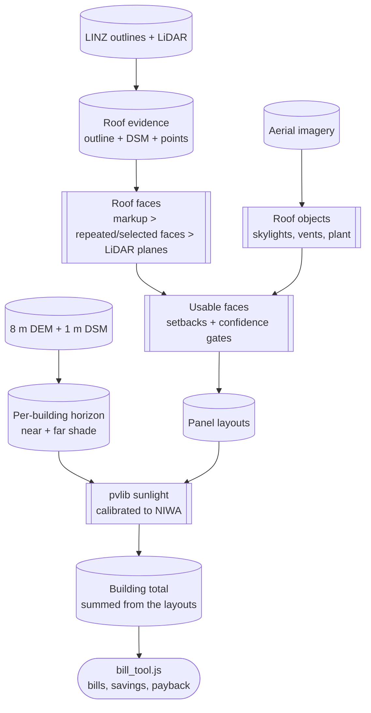

# Why a building estimate can be trusted

For researchers assessing the evidence and its limits. For a plain-English
walkthrough, start with [How a roof estimate is made](../../method.html);
financial assumptions are in [Economics](economics.md).

## In short

The estimate is a district planning estimate, not an engineering
certificate or a quote. It answers "which buildings and roof areas are
promising?", not "can this system be consented and installed without a site
visit?"

It is better than one average yield per house because each step uses its
own public dataset at building scale: the footprint from LINZ outlines, the
roof shape from LiDAR, obstructions from LiDAR and photos, sunlight from the
roof planes, and the building total summed from the same panels shown on the
map. It is limited by capture dates, resolution, classification errors,
missing imagery, and assumptions about prices and household use.

There is no independent accuracy benchmark yet. The evidence is source
provenance, automated checks, visual review, scoring against hand-drawn
roofs, and dated audits. Read audit results with their date and build
version.

## Evidence chain

Cylinders are data, boxes are stages, the rounded node is the map (same
convention as [architecture.md](../developers/architecture.md)).
[`src/derive_solar_potential.py`](../../src/derive_solar_potential.py) sums
each building's total from its layout, so a reader can inspect the panels
behind any total.

## Datasets

| Dataset | Source | Resolution and coverage | Role and limits |
| --- | --- | --- | --- |
| Building outlines | LINZ, layer `101290` | Per building | Footprint and location. Can lag demolition and new building. |
| DSM | LINZ, layer `105855`, Otago - Queenstown LiDAR 1m DSM (2021) | 1 m, 2021 survey extent | Roof and nearby object heights. Small equipment and edges can be missed. |
| DEM | LINZ, layer `105898` (1 m, 2021); NZ 8 m DEM, layer `51768`, as `data/dem_wide_mosaic.tif` | 1 m locally; 8 m for distant terrain | Terrain and horizons. No buildings or roof objects. LINZ describes the 8 m DEM as cartographic. |
| Point cloud | OpenTopography bulk store `NZ21_Otago` (2021 LINZ Otago survey) | Point returns | Plane fitting and residual tests. Limited by point density, occlusion and survey date. |
| Aerial imagery | LINZ, layer `124754`, Queenstown 0.1m Urban Aerial Photos (2026) | 0.1 m in urban areas; captured 12 Feb-3 Mar 2026 | Roof objects and currency. Affected by shadow and colour; no height. Absent in some rural areas. |
| Sunlight calibration | NIWA SolarView measured GHI (Wakatipu basin); else the nearest NIWA measured-radiation station; scaled by ERA5 spatial ratios | Monthly; ERA5 ~25 km | Corrects clear-sky sun to measured local sun. Cannot tell one roof from its neighbour; shading does that. |
| Daily sunlight | ERA5 (Copernicus, via Open-Meteo, CC BY 4.0), 1940-2025 | Daily, ~25 km | Low-solar runs and battery sizing. |
| Map imagery | LINZ Basemaps; Esri World Imagery | Display context; LINZ Basemaps also supplies registration imagery | The registration reference helps align photos; neither basemap supplies roof height. |

Layer IDs and constants live in [`config.py`](../../config.py) and
[`src/surveys.py`](../../src/surveys.py). Where this page and the code
disagree, the code is right.

## Method choices

### Which source for roof shape

Each source answers a different question:

- **DEM**: bare terrain and distant hills. No buildings.
- **DSM**: roofs, trees and structures at 1 m. A small skylight or narrow
  break may fall between cells.
- **Point cloud**: more detail; allows plane fitting and residual tests.
  Slower, and still limited by density and survey date.
- **Imagery**: the newest and finest view of visible objects, but colour is
  an indirect signal (shadow, paint, dirt and existing panels all look
  alike) and gives no height.

Roof faces come from hand-drawn markup where it exists, otherwise from a
precomputed reading (repeated-roof consensus when available, else the
best-scoring photo/line-detector/LiDAR reading), otherwise from LiDAR plane
fitting and a straight skeleton. Panels are placed at real size, clear of
edges, ridges and obstructions, and gated against the LiDAR. The result is a
feasible layout, not a survey of every centimetre.

### Obstructions and shade

Two kinds, handled apart:

1. **Hills, trees and buildings** shade the roof. Each building gets a
   72-direction horizon from the wide 8 m DEM and the 1 m DSM, taken from
   eave height.
2. **Roof objects** (vents, skylights, plant, existing arrays) are detected
   from imagery and LiDAR and kept clear of panels.

Without imagery the build runs on LiDAR alone and knows less about small
roof objects. Detection is cautious: it can block usable roof and still miss
equipment.

### Shade distances

Hills and nearby objects need different search ranges:

- **Far shade:** the building horizon searches the 8 m DEM to 20 km in 24 m
  steps. A coarser search per area (2 degree steps, 30 km, 100 m along each
  ray) sets the baseline horizon in the sunlight lookup table.
- **Near shade:** the building horizon searches the 1 m DSM to 300 m in 2 m
  steps. The per-face yield uses a narrower search (100 m, 4 degree
  azimuth steps) because it runs once per face.

The displayed horizon takes the higher of near and far in each direction.
The per-face yield applies its own shading factor. The two searches do not
share a radius, so the Horizon tab and the published kWh can differ
slightly; aligning them is open work.

### Sunlight and money

Sunlight: pvlib sun position and clear-sky model per roof slope, aspect and
latitude, scaled to measured NIWA sunlight as in the table above, then
reduced for shade and a 14% system loss (inverter included).
`config.PV_ASSUMPTIONS` holds the assumptions the map shows. The building
total comes from the layouts, so panel count, orientation, shading and
yield stay linked.

Money is calculated in the browser, not baked into the solar estimate.
[Economics](economics.md) describes the load/bill model, financial
assumptions, battery scenarios and exclusions. These are scenarios, not a
customer's real bill.

## Validation and what is left

Checks in place:

- source and coverage checks before fetching;
- geometry containment and panel gates;
- orientation sanity (north faces out-yield south faces);
- scoring against hand-drawn roofs (`tools/markup_benchmark.py`);
- renders of varied buildings; and
- obstruction, layout-quality and build-over-build audits, with a deploy
  gate against the live build.

Known failure modes: out-of-date outlines or imagery, small or curved
roofs, complex roofs, missed or over-detected equipment, missing LiDAR or
imagery, and economics that differ from a site's real load, tariff, export
limit or install cost. Structure, wiring, consent, fire and access are out
of scope.

The most useful next step for accuracy is a dated, stratified reference set
of buildings with surveyed roof faces, obstruction lists and measured
generation, reporting error by roof type, building size, coverage and
capture-date gap.
